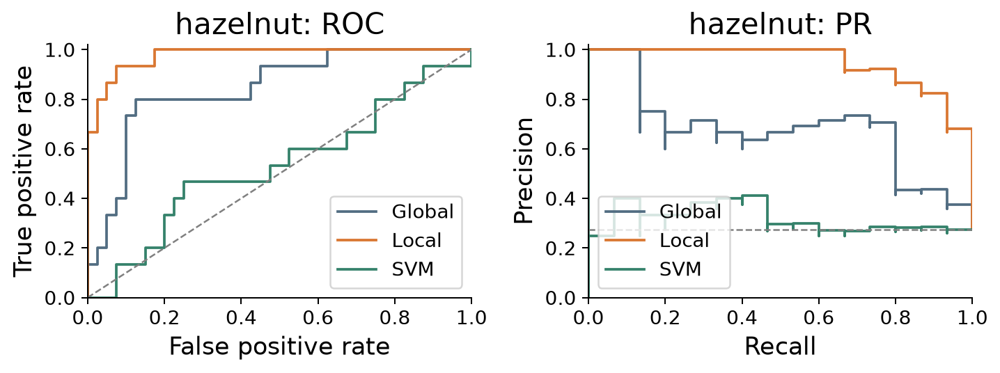
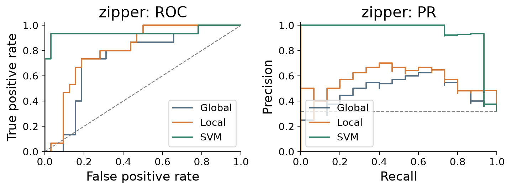
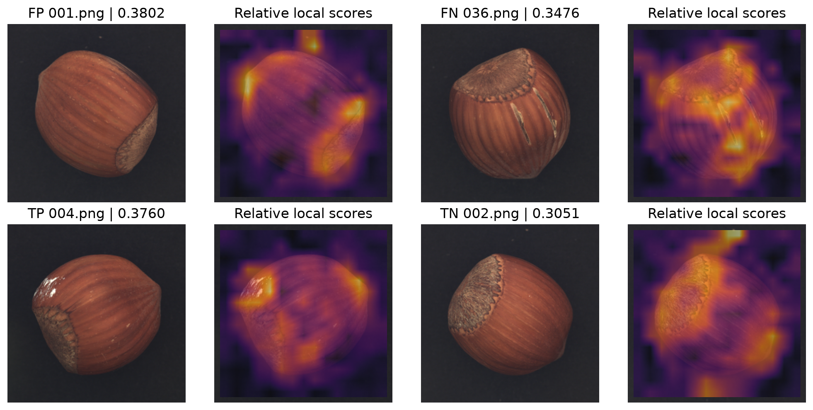
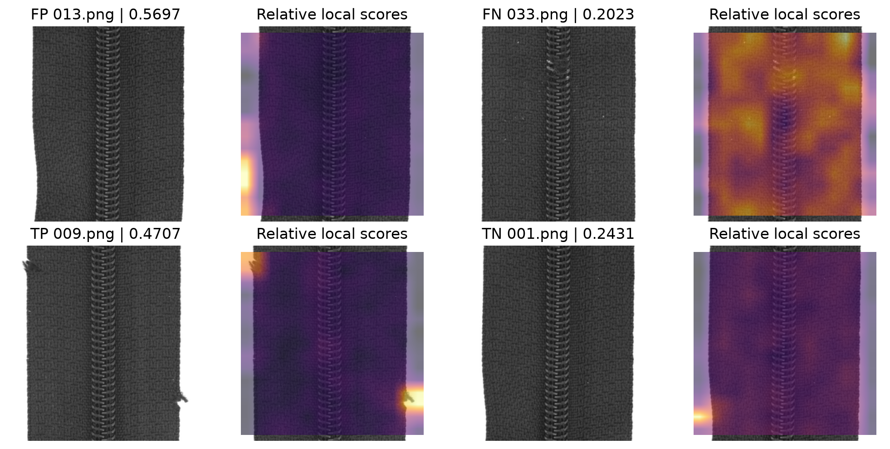
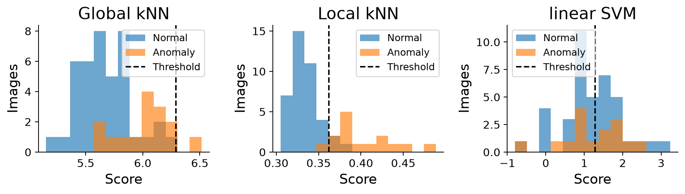
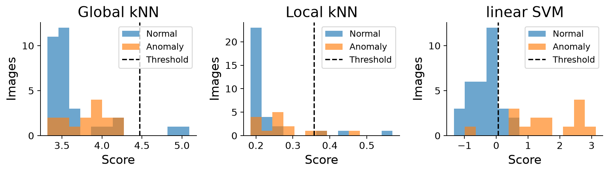

基于全局与局部 HOG 表示的图像异常检测

数据挖掘导论 2026 课程大作业 任务二

Global and Local HOG Representations for Image Anomaly Detection

## 摘要

针对榛子与拉链两类课程图像，本文比较全局 HOG 近邻距离、局部 HOG 近邻距离及有标签线性 SVM。每类原训练集在正常与异常类别内按固定种子划分；两个近邻检测器仅拟合160张正常图像，以40张正常验证图的95%分位数定阈值；SVM使用160张正常和40张异常图训练，由内部验证集选择参数和阈值。全部模型冻结后才读取测试标签。局部近邻在榛子上获得AUROC 0.9767、AP 0.9475、F1 0.8387，但在拉链上召回率仅0.1333；SVM在拉链上获得AUROC 0.9417、F1 0.8235，在榛子上表现较弱。结果表明局部表示有助于部分缺陷识别，方法适用性和阈值风险仍需分别分析。本文保留全部预定方法及失败结果，不根据测试表现更改主方法。

关键词：图像异常检测；方向梯度直方图；近邻距离；局部特征；支持向量机

## 1 问题定义与数据划分

对应2.0：给定物体类别c∈{hazelnut, zipper}及图像x，构造连续异常分数s_c(x)，分数越大表示越异常；以预先确定的阈值τ_c给出预测：当s_c(x)>τ_c时预测为异常1，否则预测为正常0。物体类别已知，各类别单独训练、校准和评价，不把榛子与拉链的区分当作正常与异常判断。

| 类别 | 拟合正常/异常 | 验证正常/异常 | 测试正常/异常 |
| --- | --- | --- | --- |
| hazelnut | 160 / 40 | 40 / 10 | 40 / 15 |
| zipper | 160 / 40 | 40 / 10 | 32 / 15 |

实际数据共602张1024×1024图片，其中榛子305张RGB图、拉链297张灰度图。测试图按类别和相对路径与JSON标签对齐，共102张。训练、验证按各类别的good/bad文件名排序后用NumPy default_rng(42)固定划分；测试保留课程原划分。所有文件及解码为RGB后的像素哈希均已检查，未发现完全重复图像。缺少物体实例标识，因此不能据此证明实例层面的独立性。

## 2 图像特征与方法动机

对应2.1：为统一两类输入，RGB图转灰度，采用Lanczos缩放至256×256，像素除以255。提取9方向HOG，单元16×16、块2×2单元、步长1单元，使用L2-Hys块归一化，不启用平方根变换[2,3]。得到15×15个36维块描述符，展平后为8100维。该表示描述局部轮廓和纹理，同时会损失颜色和细小缺陷；本文不使用预训练网络或数据增强。

## 3 检测器与阈值设计

对应2.2：三条方法路线在首次测试评价前写入experiment_protocol.json。全局近邻作为简单基线，局部近邻是预先指定的主要正常样本检测器；有标签SVM作为训练信息不同的对照。所有方法均逐类别建立模型，分数尺度不同，不直接混合两类或不同模型的原始分数。

3.1 全局HOG近邻距离

将正常拟合图的8100维HOG保存为参考集合，不再做列标准化。对查询图取欧氏距离最小的5个正常参考样本，以距离均值为s_global(x)。块归一化后的固定特征无需额外拟合；该基线便于复现，但全图距离可能稀释局部缺陷。

3.2 局部HOG近邻距离

每个32×32块在36维HOG后追加该块归一化像素的均值和标准差，形成38维描述符。对查询位置(r,c)，参考集合包含160张正常图在相同行列附近半径1，即最多3×3个块内的描述符。边界只使用实际存在的位置，不填充重复块。取3个最近参考块的平均欧氏距离d_(r,c)，再对225个位置中最大的ceil(225×0.05)=12个分数求均值，作为图像分数s_local(x)。这样既保留局部差异，又允许有限位置变化。

局部路线与全局路线同时改变了描述符内容、匹配范围和聚合方式，因此结果只能支持整体路线比较，不能将提升单独归因于某一个处理环节。热力图仅表示15×15块分数的定性投影，缺少像素掩码，不能评价像素定位精度。

3.3 有标签线性SVM与阈值

SVM输入同一8100维全局HOG。StandardScaler只拟合该类别200张拟合图，LinearSVC使用balanced类别权重，固定种子42，在C∈{0.01,0.1,1,10}中按50张混合验证图的AP最大选择，精确平局优先较小C。两类均选中C=0.01。分类分数为朝向异常类别1的decision_function，不解释为概率。

两个近邻方法的阈值分别为40张正常验证图分数的0.95线性分位数；异常验证图只用于记录效果，不决定该阈值。SVM在全部验证图上选择F1最高的严格大于阈值；依次按召回率、精确率及更大的阈值打破平局。SVM因此使用额外异常标签，不是纯正常学习，结果不构成训练信息相同的算法优劣证明。

| 类别 | 全局近邻阈值 | 局部近邻阈值 | SVM阈值 |
| --- | --- | --- | --- |
| hazelnut | 6.289067 | 0.361999 | 1.279531 |
| zipper | 4.472612 | 0.357983 | 0.068317 |

## 4 评价协议

对应2.3：正类固定为异常1。AUROC和AP由连续分数计算；另保存PR曲线梯形面积AUPRC，二者计算规则不同[5]。Precision=TP/(TP+FP)，Recall=TP/(TP+FN)，F1=2TP/(2TP+FP+FN)；无预测正类时Precision与F1置0并保留漏检计数。混淆矩阵按[[TN,FP],[FN,TP]]排列。宏平均为两个类别的指标算术平均，不混合不同尺度的分数。

拟合、SVM选参和阈值校准完成后，先保存6个模型、冻结清单及无标签测试预测，再加载JSON测试标签。未合并验证集重训，也未根据测试指标选择方法或阈值。验证样本仅50张，其中异常10张，同一验证集同时用于SVM选参和阈值校准，存在小样本选择波动。

## 5 测试结果

| 类别 | 方法 | AUROC | AP | Precision | Recall | F1 | FP/FN |
| --- | --- | --- | --- | --- | --- | --- | --- |
| hazelnut | 全局近邻 | 0.8450 | 0.6795 | 1.0000 | 0.0667 | 0.1250 | 0/14 |
| hazelnut | 局部近邻 | 0.9767 | 0.9475 | 0.8125 | 0.8667 | 0.8387 | 3/2 |
| hazelnut | 线性 SVM | 0.5300 | 0.3183 | 0.3043 | 0.4667 | 0.3684 | 16/8 |
| zipper | 全局近邻 | 0.7375 | 0.4866 | 0.0000 | 0.0000 | 0.0000 | 2/15 |
| zipper | 局部近邻 | 0.8063 | 0.5737 | 0.4000 | 0.1333 | 0.2000 | 3/13 |
| zipper | 线性 SVM | 0.9417 | 0.9440 | 0.7368 | 0.9333 | 0.8235 | 5/1 |

表1 固定协议下全部测试结果。完整AUPRC、阈值、逐图预测和混淆计数见随附指标CSV。不同训练信息分别说明，未仅保留表现较好的类别。

局部近邻的宏平均AUROC/AP/F1为0.8915/0.7606/0.5194；全局近邻为0.7913/0.5830/0.0625；SVM为0.7358/0.6312/0.5960。较好的排序指标不保证既定阈值下的高召回率，且宏平均会掩盖两个类别明显不同的表现。

榛子局部近邻检出15张异常中的13张，误报3张、漏报2张。拉链同一局部路线只检出2张，漏报13张，而SVM检出14张、误报5张。全局近邻在拉链上没有检出异常，不能因正常图多数判对而声称检测效果良好。

## 6 代表案例与定性分析

案例从预定的局部检测器输出中按固定规则选择：最高分的误报FP、最低分的漏报FN、文件名排序首个真阳TP与真阴TN。左图为输入，右图为局部异常图；每张图使用独立色标，仅比较图内相对分数，不能跨图比较亮度。所有入选路径和分数保存在selected_cases.csv。

榛子正常图001.png的纹理和端面邻域出现较高响应而被误报；异常图036.png的细长裂纹被漏检。另一个漏报029.png的分数约0.3618，非常接近阈值，说明局部可见缺陷仍可能因描述和聚合而落在阈值下。这些观察是案例分析，不等同于因果消融结论。

拉链误报013.png的较强响应集中在图像边缘与背景变化区域；漏报033.png的异常结构未形成足够大的局部分数。检出的009.png可见外缘变化。此现象提示当前距离评分可能对边界变化更敏感，对部分内部细节不够敏感；验证集局部近邻召回率也仅0.2，低召回并非只在测试时出现。

## 7 阈值表现与有效性限制

7.1 阈值与类别差异

正常验证的95%分位数仅约束校准样本的尾部位置。两个近邻方法在每类40张正常验证图上均有2张超过阈值，但这既不保证测试误报率为5%，也不保证异常召回率。榛子局部方法测试误报3/40、漏报2/15；拉链局部方法误报3/32、漏报13/15。不能根据已知测试异常数量设定要报出的异常张数，也没有在测试后移动阈值。

7.2 模型适用范围

局部路线对榛子排序与分类均优于当前全局基线，但在拉链上仍有大量漏检。SVM在拉链上较好，在榛子上AUROC只有0.53。这说明全局判别特征和正常局部参照各有边界，当前结果不支持某一种方法普遍优越。SVM可利用已知训练异常模式，比较时必须同时考虑其额外标签成本。

7.3 局限

第一，实验只有一次固定训练/验证划分，测试异常每类仅15张，未估计跨随机种子波动或置信区间。第二，灰度化、下采样及16像素单元可能削弱颜色或微小缺陷；位置容忍仍不能覆盖任意姿态。第三，仅排除了完全相同文件和像素，不能排除近重复图或同一物体相关性。第四，三个方法的部分设置由实验者事先指定，未作全面消融或复杂度公平性证明。第五，没有像素级标签，热力图不构成定位准确率证据。

## 8 结论

本文完成两类图像的读取、特征提取、模型拟合、内部校准、冻结测试评价和错误分析。局部HOG近邻在榛子上达到AUROC 0.9767、F1 0.8387；拉链的有标签SVM达到AUROC 0.9417、F1 0.8235。主要正常学习路线仍存在拉链低召回问题，全部失败结果和限制均被保留。后续若利用本次测试发现改进方法，需要新的独立评价，或明确标注为复用测试集的探索结果。

## 9 实现环境与复现证据

本次运行于Windows、Python 3.14.5，使用CPU，计算线程限制为4，图像提取最多4个工作线程。未使用GPU、预训练权重或外部图像。冷缓存完整流程含图表约19.65秒，仅为本机一次运行记录，不作为跨硬件速度比较。运行日期为2026-10-27。

| 依赖 | 实际版本 | 依赖 | 实际版本 |
| --- | --- | --- | --- |
| numpy | 2.5.4 | scipy | 1.18.1 |
| scikit-learn | 1.9.1 | scikit-image | 0.26.0 |
| Pillow | 13.0.0 | matplotlib | 3.11.2 |
| joblib | 1.6.0 | threadpoolctl | 3.7.0 |

10项针对性测试已通过，覆盖划分互斥、严格大于阈值、线性分位数、标签路径对齐、局部距离与空间邻域、HOG尺寸及RGB/灰度一致性、指标方向、非法分数和原始数据目录保护。独立核验重新解码全部102张测试图，重载6个模型得到306条预测，与保存分数的最大差异为0；另用正负样本两两比较重算AUROC、分组排序重算AP，并按整数计数复核分类指标。

602张原始图片的SHA-256在运行后逐一复核一致。数据清单、划分路径、参数、实际环境、核心代码哈希、模型哈希、冻结事件顺序、逐图验证/测试预测和全部SVM候选均已保存。冻结清单在加载测试标签前写入磁盘；原始图像和标签文件保持不变。

## 10 运行与成果组织

在本仓库目录创建独立环境，使用requirements-lock.txt安装本次完整依赖。Windows PowerShell命令如下；显式数据路径可通过--data-root指定，默认读取相邻课程数据目录。结果目录已存在时拒绝覆盖，应为复现另选新目录。

py -3.14 -m venv .venv

.\.venv\Scripts\python.exe -m pip install -r requirements-lock.txt

.\.venv\Scripts\python.exe -m unittest -v test_experiment

.\.venv\Scripts\python.exe run_experiment.py --output-dir results/reproduction

.\.venv\Scripts\python.exe verify_experiment.py --result-dir results/reproduction

results/main_20261027保存完整运行产物和6个模型；reports/main_20261027是供报告和小组协作使用的较小证据快照，包含指标、预测、划分、核验及关键图表。predict.py可直接加载模型给新图片评分，无需测试标签或重新训练。任务对应关系：第1节覆盖2.0，第2节覆盖2.1，第3节覆盖2.2，第4—8节覆盖2.3。

## 参考文献

[1] 课程资料．数据挖掘导论2026大作业说明，第3页，任务二。

[2] Dalal N, Triggs B. Histograms of Oriented Gradients for Human Detection. CVPR, 2005. 本文采用其梯度方向直方图表示思想。 [在线文档](https://lear.inrialpes.fr/people/triggs/pubs/Dalal-cvpr05.pdf)

[3] scikit-image 0.26.0 官方文档，skimage.feature.hog，访问日期2026-10-27。 [在线文档](https://scikit-image.org/docs/stable/api/skimage.feature.html#skimage.feature.hog)

[4] scikit-learn 官方文档，LinearSVC、StandardScaler 和 NearestNeighbors，访问日期2026-10-27。 [在线文档](https://scikit-learn.org/stable/modules/generated/sklearn.svm.LinearSVC.html)

[5] scikit-learn 官方评价文档，average_precision_score 与 precision_recall_curve。AP 与梯形 PR 面积采用不同计算规则。 [在线文档](https://scikit-learn.org/stable/modules/model_evaluation.html#precision-recall-f-measure-metrics)
